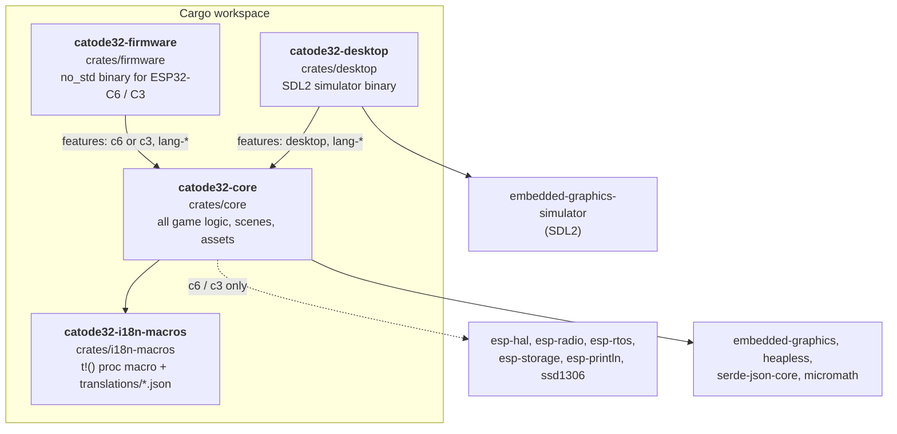
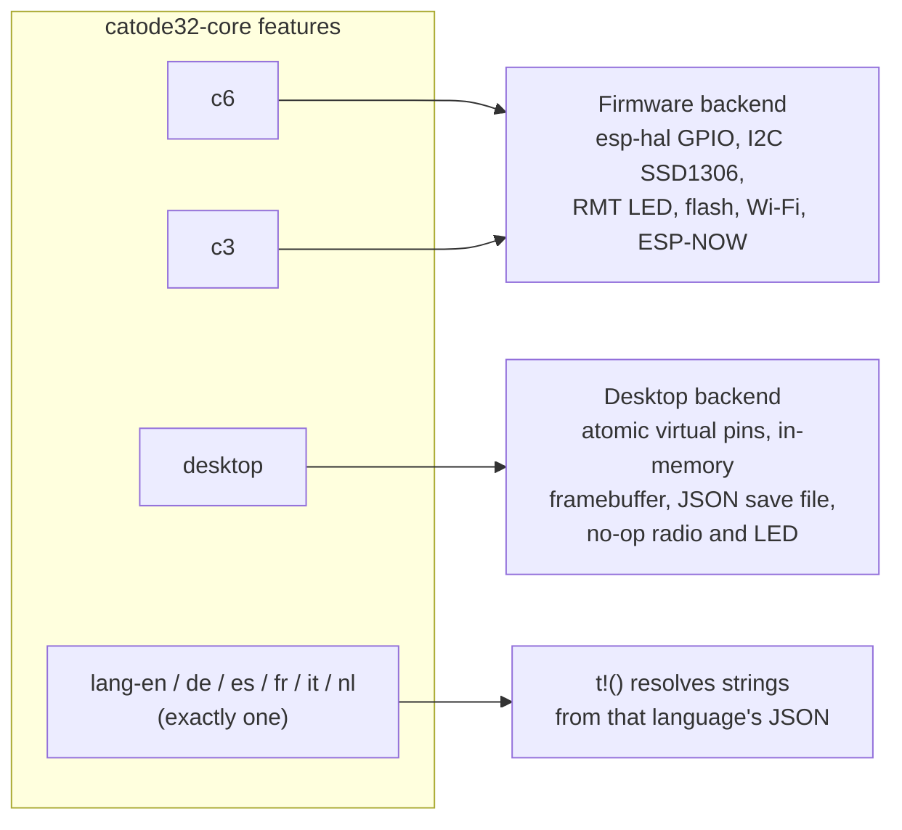
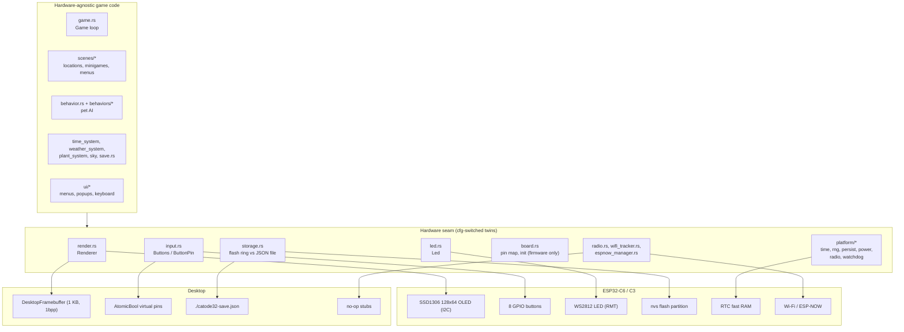
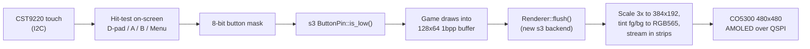
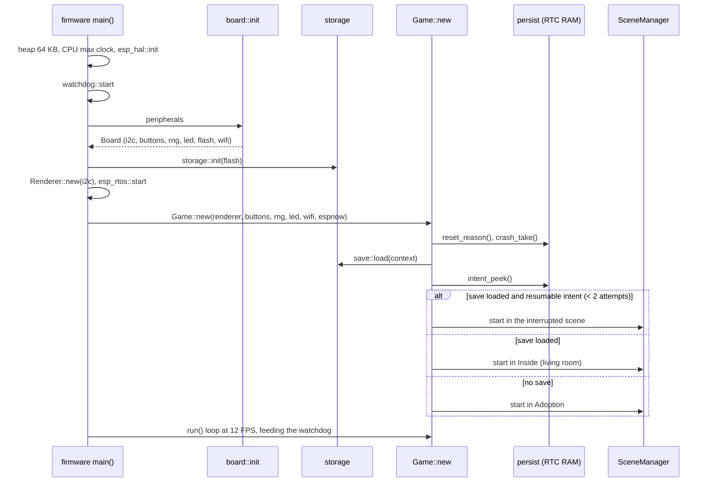
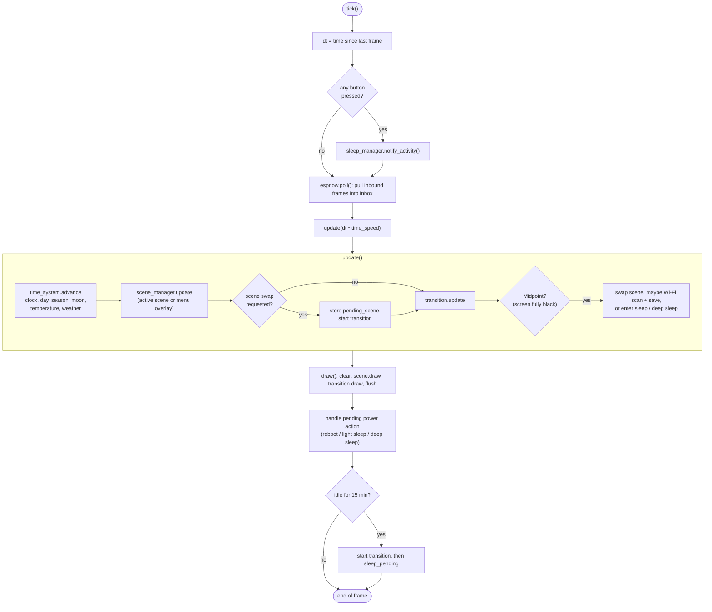
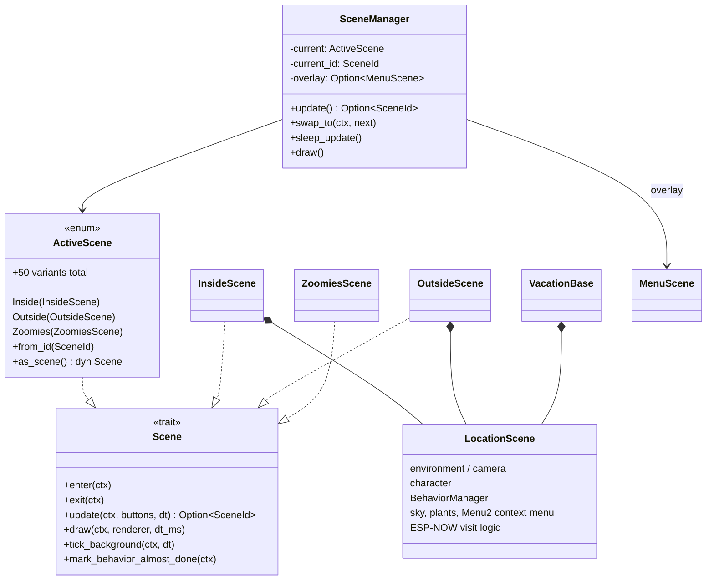
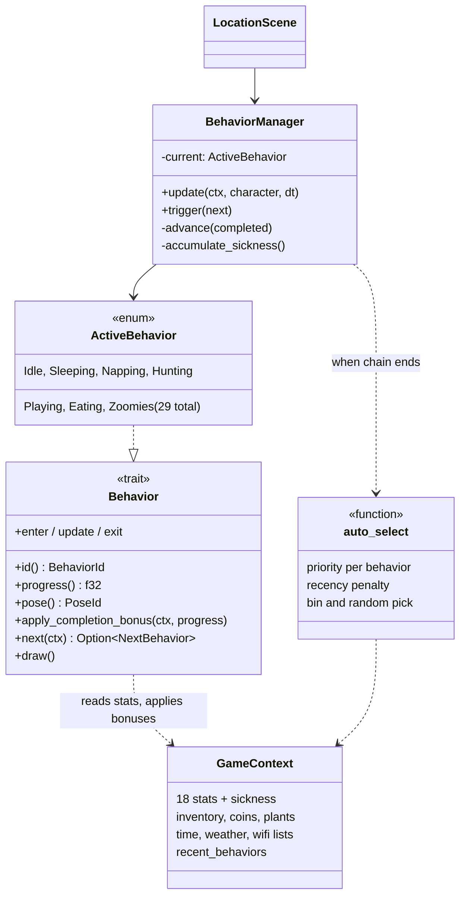
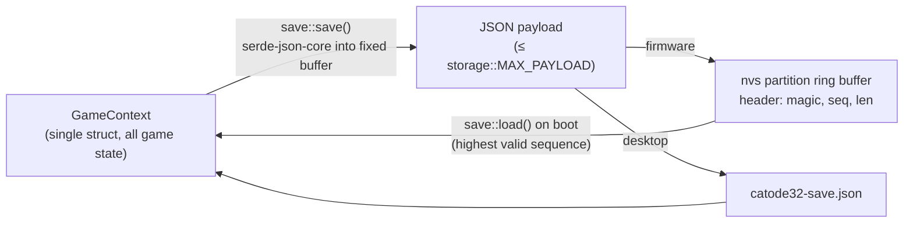
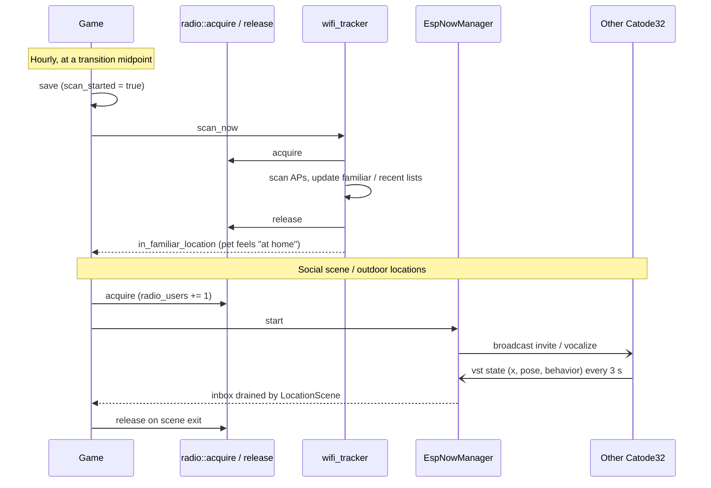

# Code architecture

How the Rust workspace is put together: which crate does what, how the same game code runs on the ESP32 and on a desktop, and where hardware-specific code lives. For what the game *does* (behaviors, stats, scenes), see [game-logic.md](game-logic.md).

## Crates

| Crate | Role |
| --- | --- |
| `core` | Everything that makes the game: game loop, scenes, pet behaviors, world systems (time, weather, plants), UI widgets, save format, sprites. `no_std` on firmware, `std` when built with `desktop`. |
| `firmware` | About 60 lines. Sets up the heap (64 KB, used by the Wi-Fi stack), the watchdog, `board::init`, storage, the `esp_rtos` scheduler, then calls `Game::new(...).run()`. `panic.rs` saves the panic message and backtrace to RTC RAM and resets. |
| `desktop` | Opens an SDL window, maps keys to the 8 buttons, calls `Game::tick()` once per frame and draws the framebuffer scaled 8x. With `--amoled` it shows the 480x480 ESP32-S3-Touch-AMOLED-2.16 layout instead, using `crates/amoled216`, and the mouse acts as touch. Also has `examples/screenshots.rs`, which generated the images in `docs/images/` (including `amoled.png`). |
| `amoled216` | Work in progress for the ESP32-S3-Touch-AMOLED-2.16 port. `no_std`, with no hardware code: the 480x480 layout (3x game viewport plus touch controls), the 1bpp→RGB565 strip scaler, the control rasterizer and touch→button-mask hit-testing. The desktop `--amoled` mode uses it now, and the S3 firmware will use it later. `crates/s3-hello` is a separate S3 toolchain smoke test outside this workspace. |
| `i18n-macros` | `t!("key")` becomes a string literal at compile time, picked from the JSON for the active `lang-*` feature, falling back to English and then to the key. No runtime cost and no string tables in RAM. |

## Feature flags select the backend

There's no runtime "platform" switch. The backend is chosen at compile time by Cargo features on `catode32-core`:

`board.rs` raises a `compile_error!` unless exactly one of `c6` / `c3` is enabled for a firmware build. The default build target in `.cargo/config.toml` is `riscv32imac-unknown-none-elf`, which is why host builds need `--target x86_64-unknown-linux-gnu`.

## The platform seam

The central rule of `core`: game code never imports `esp_hal` or `esp_println` directly. Anything that touches hardware lives behind a small set of modules, each with a firmware version and a desktop version selected by `#[cfg(feature = "desktop")]`.

What each seam module does:

| Module | Firmware | Desktop |
| --- | --- | --- |
| `render.rs` `Renderer` | Buffered `Ssd1306` over I2C | `DesktopFramebuffer`, a 1024-byte 1bpp buffer the desktop binary reads after each tick |
| `input.rs` `ButtonPin` | `esp_hal::gpio::Input` with pull-up | `AtomicBool` "virtual pin" set by `set_desktop_button` |
| `led.rs` `Led` | WS2812 via RMT on GPIO8 | No-op |
| `storage.rs` | Ring of 4 KB sectors in the 24 KB `nvs` partition, payload written before header for crash safety | `./catode32-save.json` in the working directory |
| `platform/time.rs` | esp-hal monotonic clock | `std::time::Instant` |
| `platform/persist.rs` | RTC fast RAM: scene-change intent and last panic, survive resets | Plain statics, lost on exit |
| `platform/radio.rs`, `radio.rs`, `espnow_manager.rs` | `esp-radio` Wi-Fi scans and ESP-NOW, radio acquired only while needed | Never-constructed stubs; scenes see an empty inbox |
| `platform/power.rs`, `watchdog.rs` | Software reset, task watchdog | No-ops |
| `game.rs` `enter_deep_sleep` | C6 LP-IO wake on GPIO0-3, device resets on wake | Exits the process |

### Where the S3 AMOLED port plugs in

The port (see `PORT_PLAN_S3_AMOLED.md`) adds a third backend at the same seam instead of touching game code. The plan keeps the game at 128x64 1bpp and scales it at flush time:

Files the port touches: `core/Cargo.toml` and `firmware/Cargo.toml` (an `s3` feature), `board.rs`, `render.rs`, `input.rs`, `led.rs`, `game.rs` (input poll hook, deep sleep), `firmware/src/main.rs`, and `.cargo/config.toml` (Xtensa target). Use the `waveshare-amoled-216` skill for pins and drivers.

## Boot sequence

The "intent" is a small crash-recovery mechanism. Before each scene swap the target scene ID is written to RTC RAM (no flash wear). If the device resets mid-swap, the next boot resumes into that scene, but gives up after two attempts so a scene that crashes on entry can't cause a boot loop.

## Game loop (one frame)

`Game::tick()` is the whole frame. The firmware's `run()` calls it and then busy-waits to keep 12 FPS. The desktop binary calls it from its own loop.

Things to know about the loop:

- `dt` is scaled by `context.time_speed` exactly once, in `Game::update`. Subsystems must not scale it again.
- Scene swaps never happen immediately. A scene returns `Some(SceneId)` from `update`, the screen fades out, and the swap happens at the transition midpoint while the screen is black. Slow work (Wi-Fi scans take 1-3 s) is hidden there too.
- Opening the main menu (`SceneId::Menu`) is special: `SceneManager` shows it as an overlay without exiting the current scene, and keeps the scene alive via `tick_background` so the pet keeps behaving while you browse.

## Scene system

- `SceneId` (in `scene.rs`) is a `#[repr(u8)]` enum. `SceneId::ALL` must stay in declaration order (a const assert checks it), because the numeric ID is stored for crash-resume.
- `ActiveScene` is generated by the `dispatch_enum!` macro in `scenes/mod.rs`. It is an enum holding exactly one live scene, so there's no heap allocation and only the active scene's state is in RAM.
- The five home locations and the four vacation spots are thin wrappers around `LocationScene`, which handles the camera, the pet character, behaviors, sky and weather, plants, the Menu2 context menu and playdate visits.
- Minigames, menus and debug screens implement `Scene` directly.

## Pet AI structure

See [game-logic.md](game-logic.md#how-the-pet-decides-what-to-do) for how behaviors are picked.

## State and persistence

When saves happen:

- Before each hourly Wi-Fi scan, at a transition midpoint. This doubles as the regular save.
- `save_if_needed`, called while the pet is sleeping or napping, saves if more than 75 minutes have passed since the last save.
- Before a user-requested reboot, and when the desktop simulator quits. Never during adoption.

`GameContext` uses `heapless` collections with fixed caps (see the `*_MAX` constants in `context.rs`) so RAM use is fixed. Save keys use stable English identifiers, never translated labels, so saves work across language builds. A save-shape change must stay backward compatible or bump `SCHEMA_VERSION` in `save.rs`.

## Radio usage

The radio is never on at rest. Code acquires it, uses it, and releases it; a reference count (`radio_users`) handles overlapping users.

## Code conventions worth knowing

- Use the crate's `println!` (from `lib.rs`), not `esp_println::println!`. It works on both backends.
- Use the macros in `macros.rs` (`enum_str_method!`, `enum_key_pair_option!`, `enum_key_pair_default!`, `dispatch_enum!`) for enum-to-string tables and enum dispatch.
- Sprites and art live as Rust consts in `core/src/assets/`. The art is CC BY-NC-ND (see `LICENSE`), so don't modify it.
- Most code avoids allocation. Firmware has a 64 KB heap that exists only for the Wi-Fi stack.
