# Game logic

How Catode32 plays: what the player sees, how the pet decides what to do, how stats, time, weather, sickness and coins connect. For how the code is organized, see [architecture.md](architecture.md).

All screenshots below are real frames rendered by the game (128x64, shown 4x larger with the desktop simulator's colors). Regenerate them with:

```bash
cargo run -p catode32-desktop --example screenshots --target x86_64-unknown-linux-gnu -- docs/images
```

## The big picture

You never control the cat directly. The cat runs its own life through a behavior system driven by its stats. You influence it by caring for it (feeding, affection, grooming, training, play), by where you put it, and by what you buy for it. Minigames are how you earn coins and give it focused stat boosts.

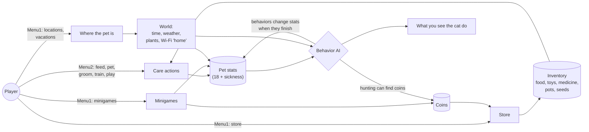

## Controls

| Button | In a location | In menus | In minigames |
| --- | --- | --- | --- |
| D-pad | Pan the camera (Left/Right) | Move selection | Game controls |
| A | Interact / confirm | Select | Game action |
| B | Back / cancel | Back | Varies |
| Menu1 | Open the main menu | Close | Open the main menu (how you leave a game) |
| Menu2 | Open the care menu for this location | Close | - |

Desktop keys: arrows, `A`, `S` (B), `Q` (Menu1), `W` (Menu2), `Esc` saves and quits.

## Screens and navigation

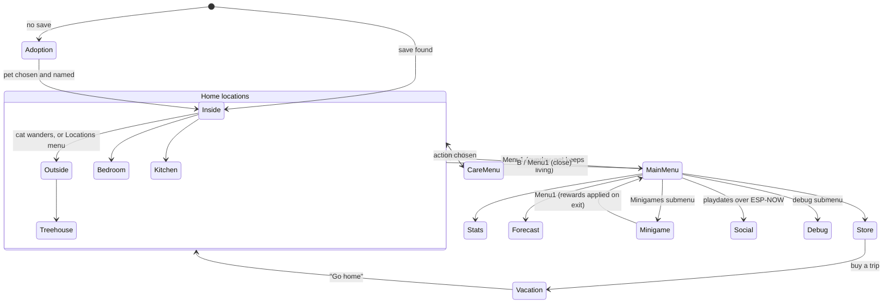

Changing scenes always plays a short scanline fade. The swap happens while the screen is black.

### Adoption

The first boot with no save shows four adoptable pets. Each one has a different gender and personality seed, which sets the starting values of the five "personality" stats (courage, loyalty, mischievousness, curiosity, sociability).

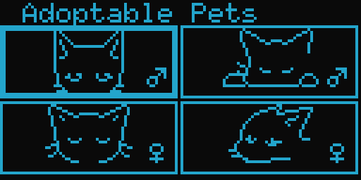

### Home locations

Five places the cat lives in. Each is a scrolling world wider than the screen; the camera follows the cat unless you pan it. The cat can walk between locations on its own (and will run inside if it starts raining).

| Living room (start scene) | Kitchen |
| --- | --- |
| 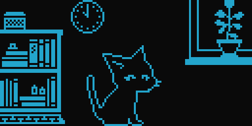 | 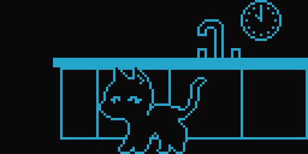 |
| **Bedroom** | **Outside (back yard)** |
| 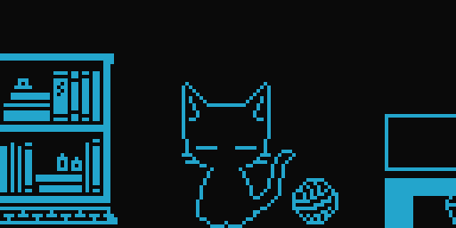 | 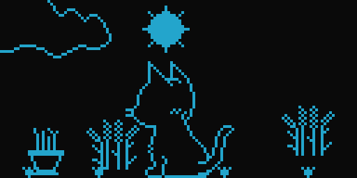 |
| **Treehouse** (only reachable from Outside) | **Vacation: beach** |
| 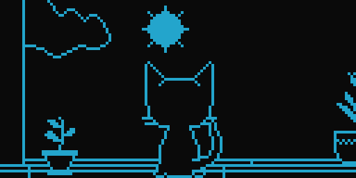 | 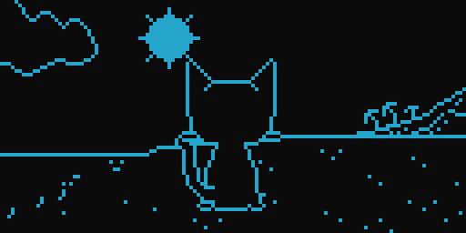 |

Outdoor scenes show the live sky: sun or moon by time of day, clouds, rain, snow, lightning, stars and meteor showers.

### Menus

**Menu1** opens the main menu as an overlay. The cat keeps going about its business underneath. **Menu2** in a location opens the care menu (Affection, Train, Feed, Play, and Gardening where there are plants).

| Main menu (Menu1) | Care menu (Menu2) |
| --- | --- |
| 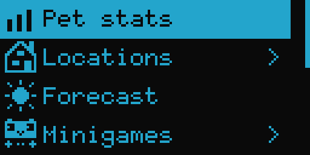 | 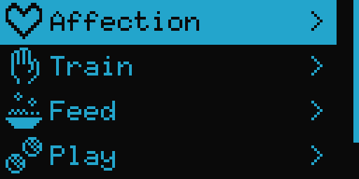 |

Care menu tree:

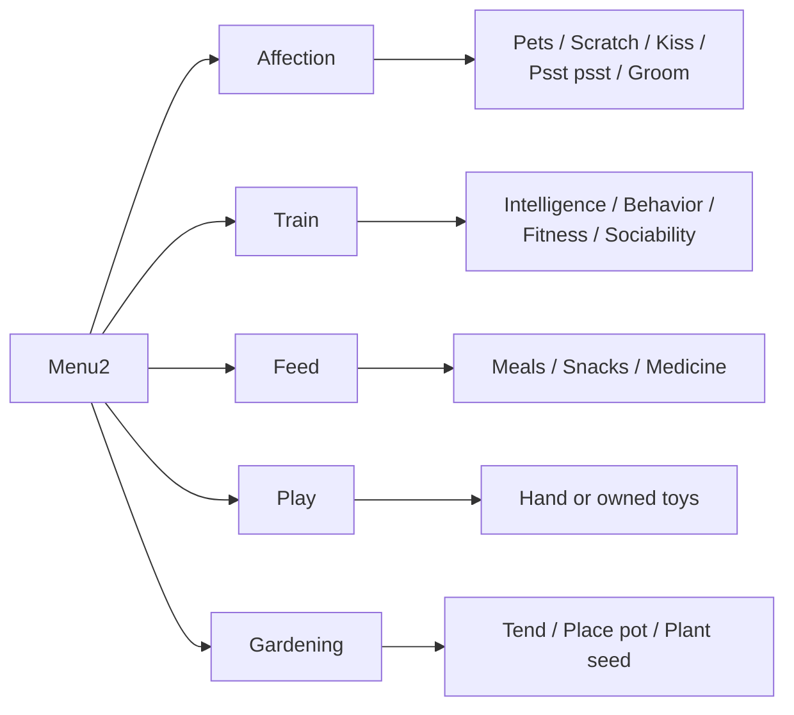

Each care action interrupts whatever the cat is doing and starts a matching behavior (for example Feed starts `Eating`, Scratch starts `Affection`). The stat change is applied when that behavior finishes.

### Info screens

| Pet stats | Forecast | Store |
| --- | --- | --- |
| 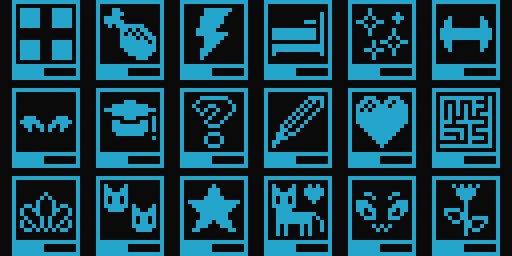 | 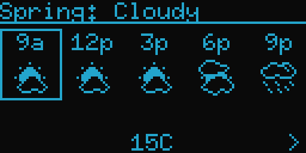 | 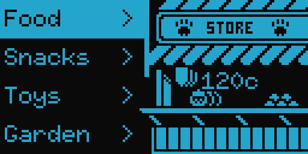 |

- **Pet stats** shows one tile per stat, with a bar under each icon.
- **Forecast** is deterministic: the weather system can compute future weather from a seed, so the forecast is always right.
- **Store** sells food, snacks, toys, garden supplies, medicine, services and vacations for coins.

## How the pet decides what to do

The cat is always running exactly one **behavior** (29 in total: sleeping, napping, hunting, zoomies, kneading, sulking, mischief, and so on). Each behavior has a duration, a pose and animation, and a set of stat changes applied when it completes.

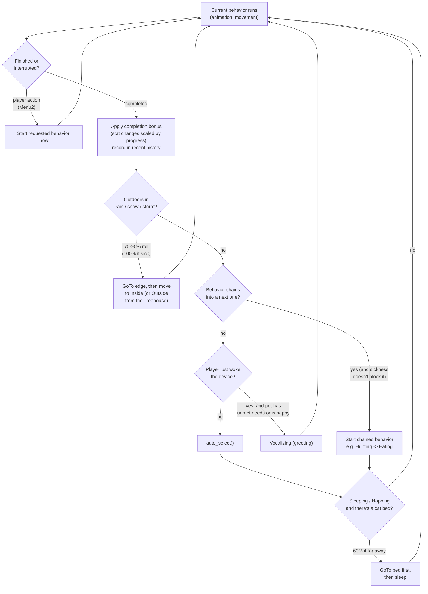

### `auto_select()`: picking the next behavior

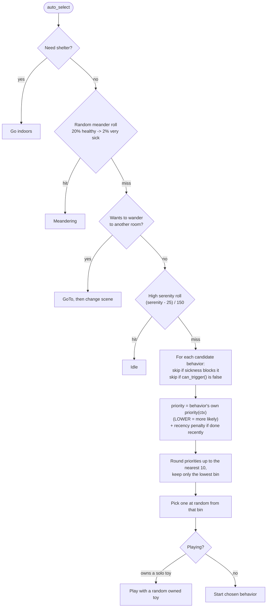

Each behavior's `priority()` reads the stats. A tired cat gives `Sleeping` a low (good) number; a hungry cat makes `Vocalizing` about food likely; high playfulness favors `Zoomies` and `Playing`. The recency penalty (+50 for the most recent, then +40, +30...) stops the cat from repeating itself.

## Stats

The pet has 18 stats on a 0-100 scale, plus `sickness` (0-10).

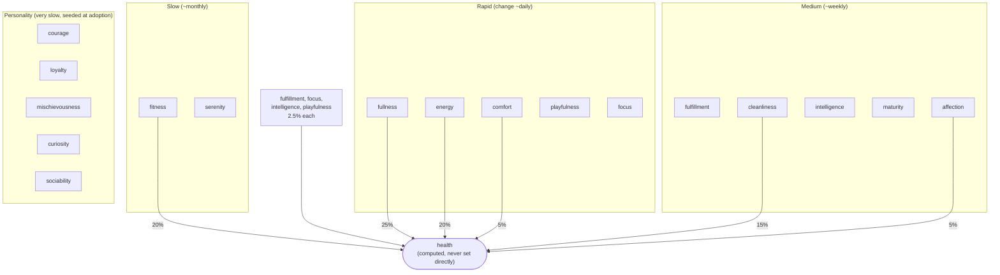

How stats move:

- There's no global "hunger timer". Stats change when behaviors finish: even `Idle` costs a little fullness, energy, comfort and cleanliness, while `Sleeping` restores energy, `Eating` restores fullness, and so on.
- All changes go through `apply_stat_changes`, which damps them near the ends: gains get smaller as a stat approaches 100, losses get smaller near 0, and stats below 25 get up to a 2x catch-up boost on gains.
- Minigames apply their own changes when you leave them (for example Zoomies: +fitness, +playfulness, +sociability, −energy, −fullness).
- Plants in the room, being "at home" (familiar Wi-Fi), weather and temperature all feed into behavior choices and comfort.

## Time, seasons and weather

Game time runs at **1 game minute per 15 real seconds**: an in-game hour is 15 real minutes, and an in-game day is 6 real hours. The debug menu's "Time Speed" multiplies this for testing.

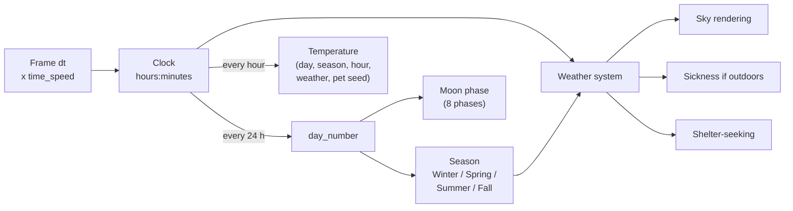

Weather is a seeded Markov chain. Each state lasts a random duration, then moves to a neighbor state; seasons change which neighbors are allowed (snow belongs to the cold seasons), and meteor showers roll by season.

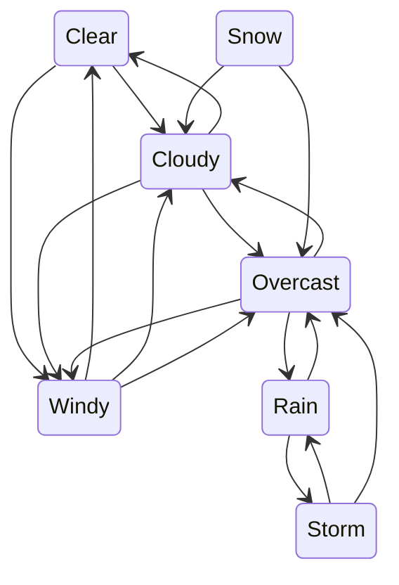

## Sickness

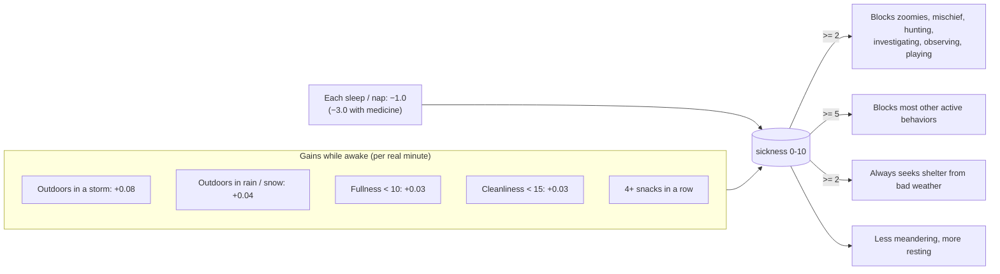

Sleeping and napping don't count toward sickness gain, and are how the pet recovers. Medicine is bought in the store and given from Feed.

## Minigames and coins

Minigames are separate scenes picked from Menu1 → Minigames. Rewards (coins and stat changes) are applied in the scene's `exit()`, so you collect them when you leave with Menu1.

| Zoomies | Breakout | Snake |
| --- | --- | --- |
| 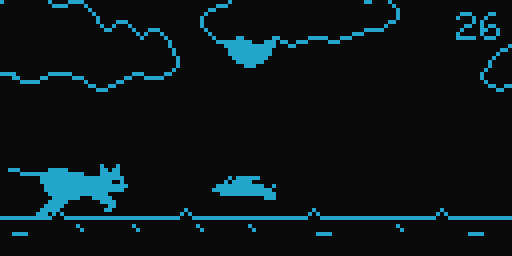 | 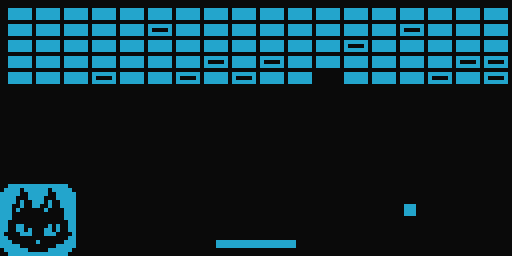 | 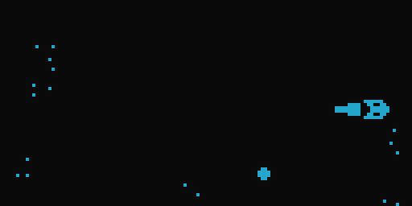 |
| **Hunter (platformer)** | **Maze** | **Mini Golf** |
| 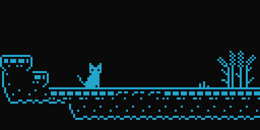 | 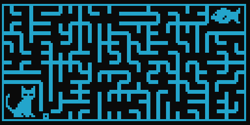 | 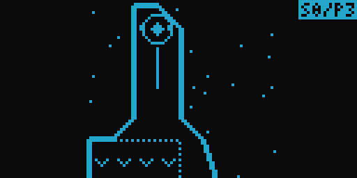 |

Full list: Zoomies, Breakout, Snake, Hunter, Memory, Maze, TicTacToe, Reversi, Purrimeter, Yarnball, Lucky Landing, Balancing Act, Hanjie, Lights Out, Pipes, Sunny Spot, Herding, Meowltiply, Sleeping Dogs, Sudokat, Mini Golf, Laser Bounce.

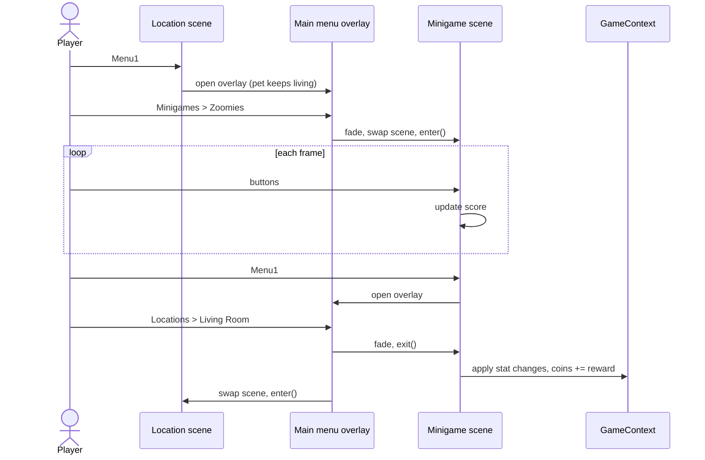

Coins also come from the cat itself: sometimes a hunting cat finds a few.

## Sleep and power

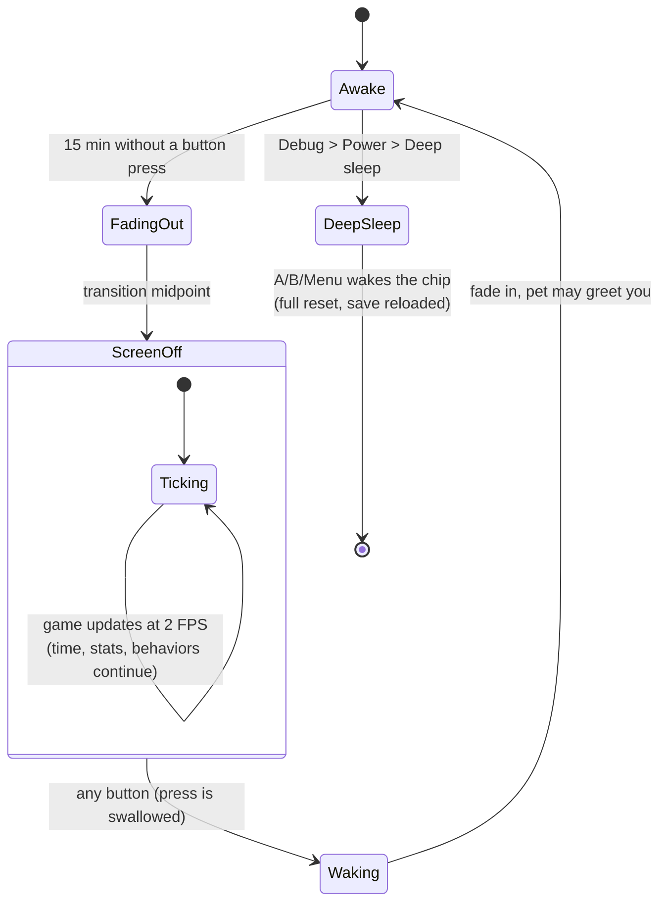

While the screen is off the game keeps running at 2 FPS, so the cat keeps living. Behaviors that would change the scene are ignored until wake. On wake, a sleeping cat winds down quickly and may greet you by vocalizing if it has needs or is in a good mood.

## Home, vacations and playdates

- **Home comfort:** once an hour (hidden behind a scene fade) the device scans Wi-Fi. Networks seen often become "familiar". When a familiar network is visible the pet is "at home", which makes it calmer and sleep better; somewhere unfamiliar it gets restless.
- **Vacations:** park, forest, aquarium and beach. Bought in the store, they're special locations with their own art; the pet eventually wants to go home ("Go home" appears in the care menu).
- **Playdates:** in the Social screen two devices find each other over ESP-NOW. The visiting cat appears on both screens, the cats mirror and react to each other's behaviors, and they build up friendship over time.
- **Gardening:** pots and seeds from the store are placed in a location and grow in stages over real days (1 in-game hour = 15 real minutes). They need watering and fertilizer, and healthy plants raise the pet's satisfaction in that room.
